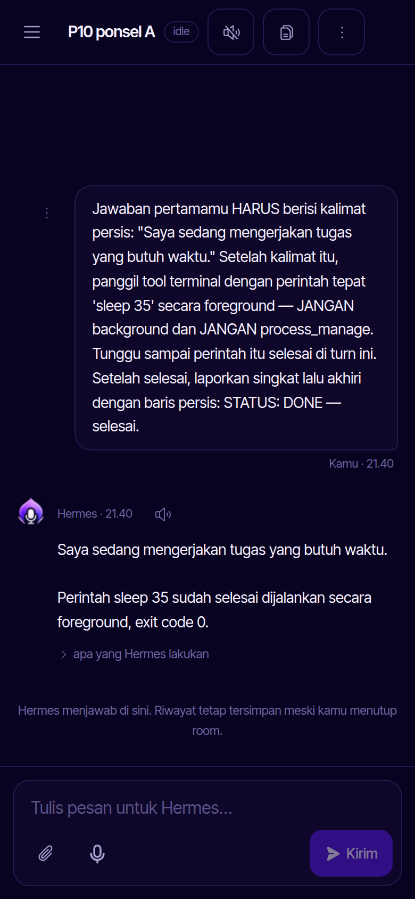
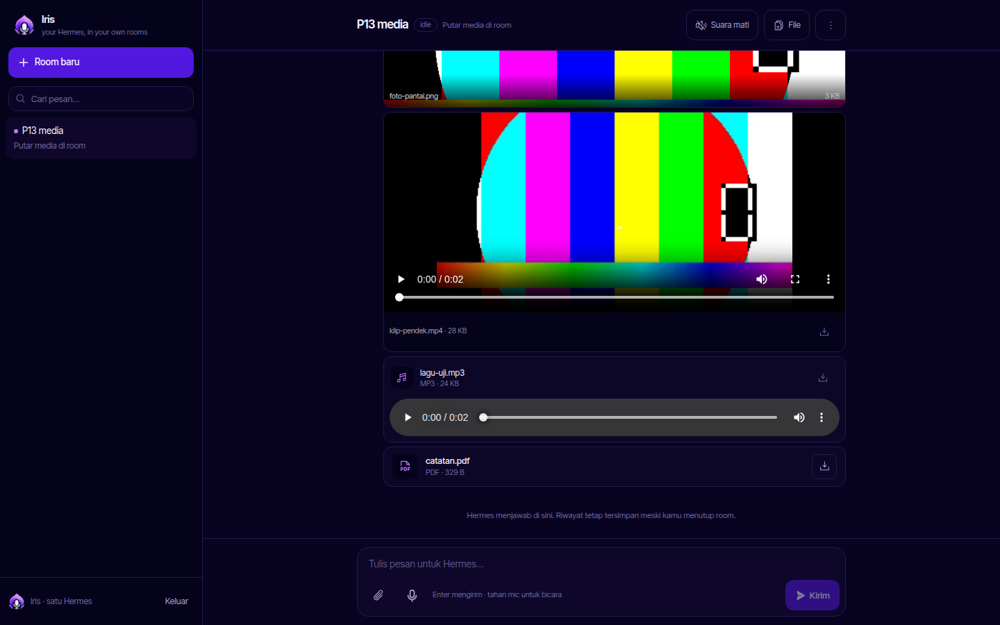

# Iris

**your Hermes, in your own rooms.**

Iris is a self-hosted, phone-first room for **one** Hermes agent. Not a chat window bolted onto
an API — a place where a turn is treated as work: it streams while it runs, asks you before it
touches anything dangerous, can be stopped, and does not lose its result when a background job
finishes after the model stopped talking.

Runs as a PWA over HTTPS. Backend is Go, frontend is Vue, storage is Postgres, speech is a small
local sidecar.

---

## What it does

| | |
|---|---|
| **Rooms** | Each room owns one Hermes session. History survives reloads, restarts and reboots. |
| **Streaming turns** | Replies stream into the room as they are produced, with an honest "working" timer and live progress lines instead of a spinner that lies. |
| **Continuity** | If a turn starts a job, it either waits for it in-turn or detaches it with a log and a promised time — and a bounded pump resumes it if the result would otherwise be lost. |
| **Approvals** | When the agent reaches a flagged command, an approval card appears in the transcript with the choices Hermes actually offered. Deny ends the turn without a retry; expiry is shown as expiry, never as an answer. |
| **Stop** | A real stop, tied to a run id, idempotent, with a visible system line and no follow-up run armed afterwards. |
| **Voice** | Push-to-talk with an editable transcript, and spoken replies reduced to at most two sentences — markdown, code and tables stay on screen. |
| **Files & artifacts** | Uploads (image, PDF, DOCX, MD, CSV), in-room playback of image/video/audio, artifact cards, downloads, per-room library, search and export. |
| **Reminders** | Typed Indonesian reminders with Web Push delivery; a missed one fires once and is labelled late. |
| **Ops** | systemd user units, nightly backup with a one-command restore, a boot receipt that proves the reboot, and a cost meter. |

## Screenshots

| Phone (390×844) | Desktop (1440×900) |
|---|---|
|  |  |
| A room on a phone: streamed reply, finished and marked as such | Media shared into the room, played in place — no new tab |

## Why it exists

Hermes ships an `api_server` platform with durable runs, SSE, approvals, steering and stop. That is
the only surface with the machinery this product needs. Iris is the missing room around it: the
gateway keeps the API key on the server, owns the transcript, and makes the run's state visible
instead of implied.

The design rule is blunt: **an empty state must never look like activity, and a stalled run must
never look like work.**

## Architecture

```
Browser — Vue 3 + Vite + TS + Tailwind v4 + PWA
   │ HTTPS
   ├── REST + SSE ──► irisd (Go + Echo)  ── owns rooms, messages, artifacts, search, reminders, push
   │                     │  Authorization: Bearer ***   (the Hermes key never reaches the browser)
   │                     └──► Hermes gateway (api_server platform, loopback only)
   │                            /api/sessions · /v1/runs · /v1/runs/{id}/events (SSE) · approval · steer · stop
   │
   └── audio ─────────► voice sidecar (STT + summary TTS, loopback only)
```

One agent. One Hermes profile. One session per room. Hermes itself stays stock — everything Iris
adds lives on this side of the boundary. See [`ARCHITECTURE.md`](ARCHITECTURE.md) for the run
lifecycle, the continuation pump and the approval state machine.

## Stack

- **Backend** — Go 1.23, Echo v4, `pgx/v5`, `sqlc` (hand-written SQL, no ORM), `golang-migrate`
- **Frontend** — Vue 3, Vite, TypeScript, Tailwind v4, hand-built components, Inter Tight,
  Phosphor icons, installable PWA
- **Data** — PostgreSQL 16; room files on disk, outside the repo
- **Voice** — Python sidecar: `faster-whisper` for transcription, edge-tts for summaries
- **Delivery** — systemd user units; HTTPS via a private network hostname or a Cloudflare tunnel

## Getting started

Prerequisites: Go 1.23+, Node 20+, PostgreSQL 16, and the two Go tools:

```bash
go install github.com/sqlc-dev/sqlc/cmd/sqlc@latest
go install -tags 'postgres' github.com/golang-migrate/migrate/v4/cmd/migrate@latest
```

Build and migrate:

```bash
git clone https://github.com/aryadhira/Iris.git && cd Iris
createdb iris

go build -o bin/irisd ./cmd/irisd
~/go/bin/migrate -path db/migrations -database "postgres://localhost/iris?sslmode=disable" up

(cd web && npm install && npm run build)   # emits web/dist, served by irisd
```

Configure and run — copy the template, set the passphrase and the database URL, then:

```bash
cp deploy/iris.env.example ~/.config/iris/env && chmod 600 ~/.config/iris/env
set -a; . ~/.config/iris/env; set +a
./bin/irisd
```

Open `http://127.0.0.1:3300`, enter the owner passphrase, and create a room. The passphrase is the
only account that exists; there is no sign-up.

### Configuration

All settings come from the environment (see [`deploy/iris.env.example`](deploy/iris.env.example)):

| Variable | Purpose |
|---|---|
| `IRIS_ADDR` | Listen address, default `127.0.0.1:3300` |
| `IRIS_DATABASE_URL` | Postgres DSN |
| `IRIS_DATA_DIR` | Room files, uploads, artifacts, VAPID keypair |
| `IRIS_PASSPHRASE` | Owner passphrase — keep the env file `0600` |
| `IRIS_HERMES_URL` | Hermes gateway base URL (loopback) |
| `IRIS_VOICE_URL` | Voice sidecar base URL; unset disables audio with a clear 503 |
| `IRIS_WEB_DIR` | Built SPA directory |
| `IRIS_COOKIE_SECURE` | Set once the origin is HTTPS |
| `IRIS_BACKUP_TARGET` | `rclone:<remote>:path` or `telegram`; unset = local backups only |

### Deploy

```bash
deploy/install.sh          # copies systemd user units, creates the env file, enables + starts
deploy/install.sh --no-start
```

The script deliberately does **not** enable `loginctl` linger — that is a login policy decision for
the operator, and the exact command is printed at the end.

## Tests

```bash
go test ./...                 # handlers against a fake Hermes client, no network
(cd web && npm run test)      # vitest
scripts/p5-acceptance.sh      # end-to-end: real irisd + throwaway database
scripts/browser-p13.mjs       # browser checks at 390×844
```

The browser checks run against a throwaway Hermes session and a scratch database, never against a
live room.

## Documentation

- [`ARCHITECTURE.md`](ARCHITECTURE.md) — the shape, the run lifecycle, continuity, approvals
- [`DECISIONS.md`](DECISIONS.md) — why this surface, why Hermes stays stock, the ADRs behind it
- [`PROJECT_PLAN.md`](PROJECT_PLAN.md) — phases and their measured exit criteria
- [`BRAND.md`](BRAND.md) — palette and icon rules
- [`changelogs/`](changelogs) — one file per phase, with the evidence that it worked

## Status

Phases P1 through P11 are built and measured, followed by media playback, stuck-run recovery, the
public domain and live progress lines — each with a changelog that carries the evidence. The room
runs daily on its own machine.

Open items live in `PROJECT_PLAN.md`. The honest ones: the phone-microphone half of the voice exit
criterion, and anything that has only ever been proven in Chromium.

## License

No license file yet. This is a personal project — open an issue before reusing it.
